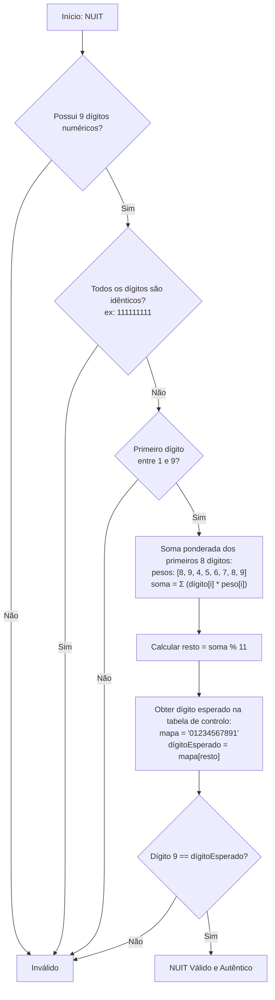
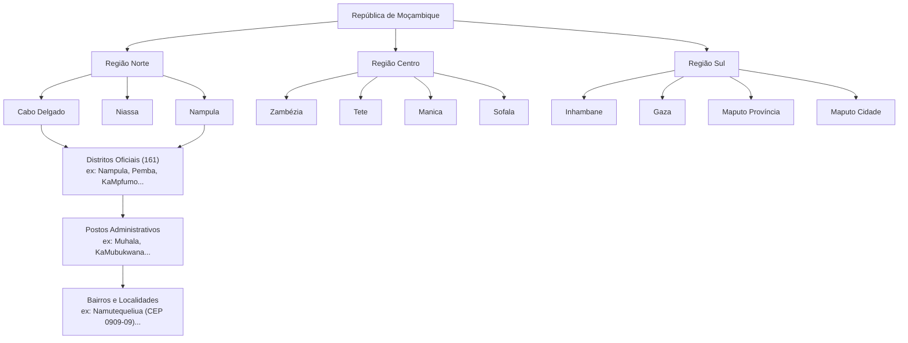

# Documentação de Arquitetura e Especificações Técnicas (Mozambique Kiwi) 🇲🇿

Este documento reúne referências arquiteturais profundas, fluxogramas de validação algorítmica e estruturas administrativas oficiais de Moçambique utilizadas pelo pacote `moz-utils`.

---

## 1. Validação de Documentos Oficiais

### Bilhete de Identidade (B.I.) Moçambicano
- **Estrutura**: Exatamente 12 dígitos numéricos seguidos de 1 letra maiúscula.
- **Exemplo**: `110101234567A`.
- **Regras de Validação**:
  - Remove automaticamente espaços em branco e hífens.
  - Converte caracteres alfabéticos para maiúsculas.
  - Valida conformidade estrita com a expressão regular `/^\d{12}[A-Z]$/`.

### Fluxograma do Algoritmo NUIT (Módulo 11 da Autoridade Tributária)

A validação do NUIT obedece com rigor matemático às regras estipuladas pela Autoridade Tributária de Moçambique (AT):



#### Classificação da Entidade pelo Primeiro Dígito do NUIT
| Primeiro Dígito | Natureza Jurídica / Entidade |
| :---: | :--- |
| **`1`, `2`, `3`** | Pessoas Singulares |
| **`4`, `5`** | Pessoas Colectivas |
| **`6`** | Entidades Equiparadas (Associações, Fundações, Cooperativas) |
| **`7`** | Estado / Instituições e Empresas Públicas |
| **`8`** | Outras Entidades (ONGs, Missões Diplomáticas) |
| **`9`** | Entidades Estrangeiras / Não Residentes |

---

## 2. Sistema Bancário de Moçambique (NIB & IBAN)

O sistema de pagamentos de Moçambique, regulado pelo Banco de Moçambique e operado pela rede SIMO, adota o padrão NIB de 21 dígitos:

### Estrutura do NIB (21 dígitos)
```text
BBBB . AAAA . CCCCCCCCCCC . KK
 │      │         │          └─ Dígitos de Controlo (2 dígitos, ISO 7064 Módulo 97-10)
 │      │         └──────────── Número de Conta Bancária (11 dígitos)
 │      └────────────────────── Código do Balcão / Agência (4 dígitos)
 └───────────────────────────── Código da Instituição Bancária (4 dígitos)
```

### Algoritmo de Validação ISO 7064 MOD 97-10
Para qualquer NIB moçambicano matematicamente válido:
$$\text{NIB} \pmod{97} = 1$$
Em linguagens de programação, avalia-se utilizando inteiros de precisão arbitrária:
$$\text{BigInt(nib)} \pmod{97\text{n}} == 1\text{n}$$

### Formato Internacional IBAN (ISO 13616)
Moçambique adota o prefixo de país `MZ` e os dígitos de controlo internacionais fixos `59`, resultando em 25 caracteres alfanuméricos:
$$\text{IBAN} = \text{"MZ59"} + \text{NIB (21 dígitos)}$$

---

## 3. Hierarquia Geográfica e Territorial

Uma base de dados relacional estática que modela a divisão político-administrativa do território moçambicano:



### Quadro Oficial de Províncias e Principais Distritos

| Região | Província | Capital | Distritos Principais |
| :--- | :--- | :--- | :--- |
| **Sul** | Cidade de Maputo | Maputo | KaMpfumo, KaNhlamankulu, KaMaxaquene, KaMavota, KaMubukwana, KaTembe, KaNyaka |
| **Sul** | Província de Maputo | Matola | Matola, Boane, Marracuene, Manhiça, Moamba, Magude, Matutuíne, Namaacha |
| **Sul** | Gaza | Xai-Xai | Xai-Xai, Chókwè, Chibuto, Bilene, Macia, Mandlakazi, Massingir, Guijá, Mabalane |
| **Sul** | Inhambane | Inhambane | Inhambane, Maxixe, Vilankulo, Morrumbene, Massinga, Zavala, Inharrime, Jangamo |
| **Centro** | Sofala | Beira | Beira, Dondo, Búzi, Gorongosa, Nhamatanda, Marromeu, Caia, Cheringoma |
| **Centro** | Manica | Chimoio | Chimoio, Manica, Gondola, Sussundenga, Mossurize, Bárue, Vanduzi, Macate |
| **Centro** | Tete | Tete | Tete, Moatize, Angónia, Cahora Bassa, Changara, Mutarara, Tsangano, Marávia |
| **Centro** | Zambézia | Quelimane | Quelimane, Mocuba, Gurúè, Milange, Alto Molócuè, Morrumbala, Maganja da Costa |
| **Norte** | Nampula | Nampula | Nampula, Nacala-Porto, Angoche, Ilha de Moçambique, Monapo, Ribáuè, Meconta |
| **Norte** | Cabo Delgado | Pemba | Pemba, Montepuez, Mocímboa da Praia, Chiúre, Palma, Mueda, Ancuabe, Macomia |
| **Norte** | Niassa | Lichinga | Lichinga, Cuamba, Lago, Mandimba, Marrupa, Mecanhelas, Majune, Sanga |

---

## 4. Sistema Postal e o Novo CEP de Moçambique

Moçambique implementou o **Novo Código de Endereçamento Postal (CEP)** com o formato estrutural `XXXX-XX` (6 dígitos divididos por hífen), substituindo os antigos códigos postais postais de 4 dígitos.

- **Exemplo de Referência**:
  - Província: **Nampula**
  - Distrito: **Nampula**
  - Localidade / Bairro: **Namutequeliua**
  - CEP Novo Homologado: **`0909-09`** (antigo código genérico: `3100`)

O `moz-utils` contém o mapeamento bidirecional integral entre os códigos legados de 4 dígitos e a base oficial de **555 novos CEPs**, permitindo sugestões automáticas e autocomplete em formulários web e mobile.
