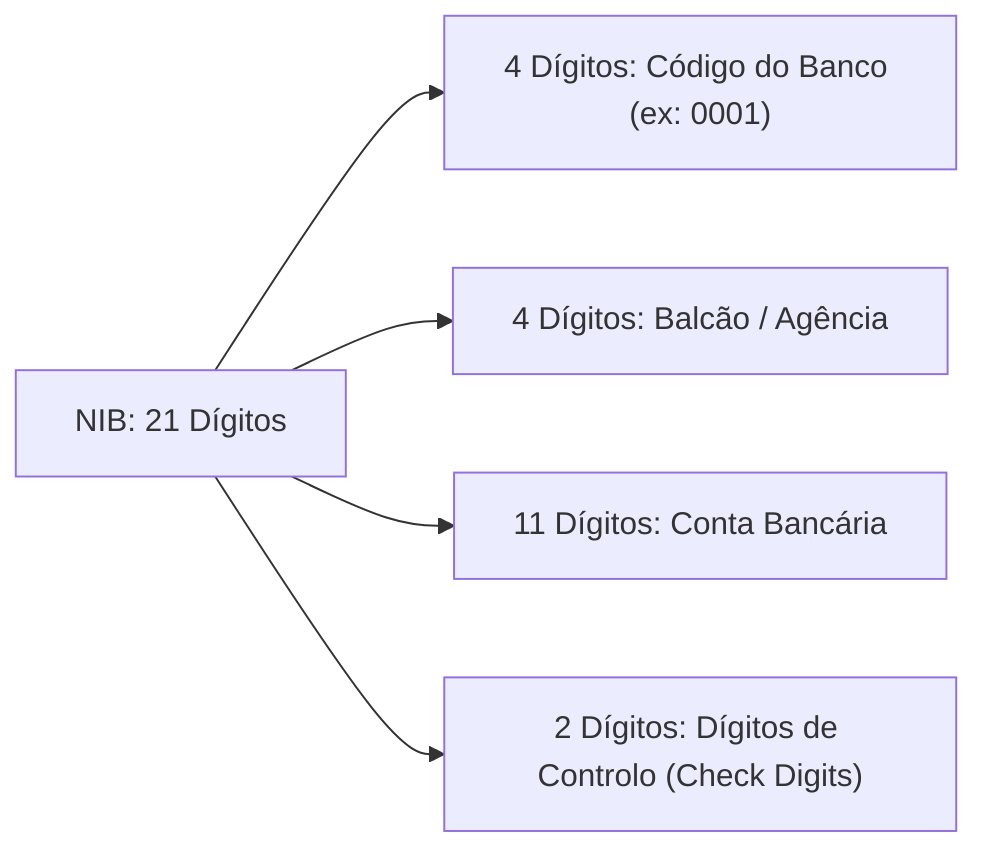

# Módulo Bancário de Moçambique (NIB & IBAN)

O sistema bancário moçambicano opera sob a regulamentação do **Banco de Moçambique** e a rede nacional de compensação eletrónica interbancária (**SIMO**). O `moz-utils` v0.4.0 introduz suporte completo à validação, formatação e identificação de contas bancárias em Moçambique.

---

## 🏛️ Estrutura do NIB Moçambicano (21 Dígitos)

O **Número de Identificação Bancária (NIB)** é composto estritamente por 21 dígitos numéricos divididos em quatro blocos funcionais:



### Algoritmo de Validação (ISO 7064 MOD 97-10)
A validação matemática do NIB em Moçambique obedece à norma internacional **ISO 7064 Módulo 97-10**:
- Ao converter os 21 dígitos em inteiro grande (*BigInt*), o resto da divisão por **97** deve ser exatamente igual a **1** (`BigInt(NIB) % 97 === 1`).
- O código do banco (primeiros 4 dígitos) deve pertencer à lista oficial de instituições financeiras autorizadas.

---

## 🌍 Estrutura do IBAN Moçambicano (25 Caracteres)

Conforme a norma internacional ISO 13616 e a diretiva do Banco de Moçambique:
- Prefixo fixo: `MZ` (código de país ISO 3166-1 alpha-2).
- Dígitos de controlo internacionais fixos para Moçambique: `59`.
- Seguido integralmente pelos 21 dígitos do NIB nacional.
- **Tamanho total:** 25 caracteres alfanuméricos (ex: `MZ59000100001234567890194`).

---

## Validar NIB (`isValidNIB`)

A função `isValidNIB` verifica se o número possui 21 dígitos, se o código da instituição existe e se cumpre o Módulo 97-10:

<div className="code-tabs" data-labels="TypeScript,Python,PHP,Dart,Kotlin">

```ts
import { isValidNIB } from 'moz-utils';

console.log(isValidNIB('000100001234567890194')); // true (Millennium BIM)
console.log(isValidNIB('000800001234567890194')); // false (dígito de controlo divergente)
console.log(isValidNIB('999900001234567890194')); // false (código de banco inexistente)
```

```python
from moz_utils import is_valid_nib

print(is_valid_nib("000100001234567890194")) # True
print(is_valid_nib("999900001234567890194")) # False
```

```php
use Iradoweck\MozUtils\MozUtils;

echo MozUtils::isValidNIB("000100001234567890194"); // true
```

```dart
import 'package:moz_utils/moz_utils.dart';

print(isValidNIB('000100001234567890194')); // true
```

```kotlin
import com.edmilsonmuacigarro.mozutils.MozUtils

println(MozUtils.isValidNIB("000100001234567890194")) // true
```

</div>

---

## Formatar NIB (`formatNIB`)

Apresenta o NIB no formato padrão legível de 4 blocos (`0001 0000 12345678901 94`) ou separado por pontos:

<div className="code-tabs" data-labels="TypeScript,Python,PHP,Dart,Kotlin">

```ts
import { formatNIB } from 'moz-utils';

console.log(formatNIB('000100001234567890194'));
// "0001 0000 12345678901 94"

console.log(formatNIB('000100001234567890194', '.'));
// "0001.0000.12345678901.94"
```

```python
from moz_utils import format_nib

print(format_nib("000100001234567890194"))
# "0001 0000 12345678901 94"
```

```php
use Iradoweck\MozUtils\MozUtils;

echo MozUtils::formatNIB("000100001234567890194");
// "0001 0000 12345678901 94"
```

```dart
import 'package:moz_utils/moz_utils.dart';

print(formatNIB('000100001234567890194'));
// "0001 0000 12345678901 94"
```

```kotlin
import com.edmilsonmuacigarro.mozutils.MozUtils

println(MozUtils.formatNIB("000100001234567890194"))
// "0001 0000 12345678901 94"
```

</div>

---

## Identificar o Banco a Partir do NIB (`getBankFromNIB` / `getBankByNIB`)

Extrai os 4 primeiros dígitos do NIB e retorna os dados cadastrais da instituição financeira:

<div className="code-tabs" data-labels="TypeScript,Python,PHP,Dart,Kotlin">

```ts
import { getBankFromNIB } from 'moz-utils';

const bank = getBankFromNIB('000100001234567890194');
console.log(bank);
// {
//   code: "0001",
//   name: "Banco Internacional de Moçambique",
//   shortName: "Millennium BIM"
// }
```

```python
from moz_utils import get_bank_from_nib

bank = get_bank_from_nib("000800001234567890123")
print(bank.short_name) # "BCI"
```

```php
use Iradoweck\MozUtils\MozUtils;

$bank = MozUtils::getBankFromNIB("000300001234567890123");
echo $bank['shortName']; // "Standard Bank"
```

```dart
import 'package:moz_utils/moz_utils.dart';

final bank = getBankFromNIB('003400001234567890123');
print(bank?.shortName); // "Moza Banco"
```

```kotlin
import com.edmilsonmuacigarro.mozutils.MozUtils

val bank = MozUtils.getBankFromNIB("000100001234567890194")
println(bank?.shortName) // "Millennium BIM"
```

</div>

---

## Conversão e Validação de IBAN (`nibToIBAN` & `isValidIBAN`)

Gera o código internacional IBAN com prefixo `MZ59` ou valida se uma transferência internacional tem destino moçambicano válido:

<div className="code-tabs" data-labels="TypeScript,Python,PHP,Dart,Kotlin">

```ts
import { nibToIBAN, isValidIBAN } from 'moz-utils';

const iban = nibToIBAN('000100001234567890194');
console.log(iban); // "MZ59000100001234567890194"

console.log(isValidIBAN('MZ59000100001234567890194')); // true
console.log(isValidIBAN('PT50000100001234567890194')); // false (não é Moçambique)
```

```python
from moz_utils import nib_to_iban, is_valid_iban

iban = nib_to_iban("000100001234567890194")
print(iban) # "MZ59000100001234567890194"
print(is_valid_iban(iban)) # True
```

```php
use Iradoweck\MozUtils\MozUtils;

$iban = MozUtils::nibToIBAN("000100001234567890194");
echo MozUtils::isValidIBAN($iban); // true
```

```dart
import 'package:moz_utils/moz_utils.dart';

final iban = nibToIBAN('000100001234567890194');
print(isValidIBAN(iban)); // true
```

```kotlin
import com.edmilsonmuacigarro.mozutils.MozUtils

val iban = MozUtils.nibToIBAN("000100001234567890194")
println(MozUtils.isValidIBAN(iban)) // true
```

</div>

---

## 📋 Catálogo Oficial de Bancos em Moçambique

Abaixo constam as instituições cadastradas na base oficial do Banco de Moçambique e suportadas nativamente pelo `moz-utils`:

| Código | Nome Comercial / Curto | Razão Social Oficial |
| :--- | :--- | :--- |
| `0001` | **Millennium BIM** | Banco Internacional de Moçambique, S.A. |
| `0003` | **Standard Bank** | Standard Bank Moçambique, S.A. |
| `0006` | **Absa** | Absa Bank Moçambique, S.A. |
| `0007` | **Nedbank** | Nedbank Moçambique, S.A. |
| `0008` | **BCI** | Banco Comercial e de Investimentos, S.A. |
| `0014` | **FNB** | First National Bank Moçambique, S.A. |
| `0016` | **Moza Banco** | Moza Banco, S.A. |
| `0021` | **Access Bank** | Access Bank Moçambique, S.A. |
| `0024` | **Ecobank** | Ecobank Moçambique, S.A. |
| `0025` | **BNI** | Banco Nacional de Investimento, S.A. |
| `0030` | **Société Générale** | Société Générale Moçambique, S.A. |
| `0034` | **Moza Banco** | Moza Banco, S.A. |
| `0038` | **First Capital Bank**| First Capital Bank Moçambique, S.A. |
| `0041` | **Letshego** | Banco Letshego, S.A. |
| `0043` | **First Capital Bank**| First Capital Bank Moçambique, S.A. |
| `0044` | **MyBucks** | MyBucks Banking Corporation, S.A. |
| `0045` | **BDM** | Banco de Desenvolvimento de Moçambique, S.A. |
| `0048` | **Banco Mais** | Banco Mais, S.A. |
| `0050` | **Standard Chartered** | Standard Chartered Bank Moçambique, S.A. |
| `0052` | **Banco Big** | Banco Big Moçambique, S.A. |
| `0056` | **Letshego** | Banco Letshego, S.A. |
| `0057` | **BNI** | Banco Nacional de Investimento, S.A. |
