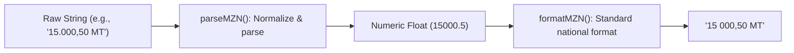

# Currency (MZN)

Formatting and parsing monetary values in Mozambican Meticais requires strict compliance with local banking conventions: spaces as thousands separators, commas for decimal places, and standard currency symbols (`MT` or `MZN` under ISO 4217).

---

## 💶 Parsing & Formatting Pipeline



---

## Format Meticais (`formatMZN`)

<div className="code-tabs" data-labels="TypeScript,Python,PHP,Dart,Kotlin">

```ts
import { formatMZN } from 'moz-utils';

console.log(formatMZN(15000.5));        // "15 000,50 MT"
console.log(formatMZN(1234567.89));     // "1 234 567,89 MT"
console.log(formatMZN(1500, 'MZN'));     // "1 500,00 MZN"
```

```python
from moz_utils import format_mzn

print(format_mzn(15000.5))        # "15 000,50 MT"
```

```php
use MozUtils\MozUtils;

echo MozUtils::formatMZN(15000.5); // "15 000,50 MT"
```

```dart
import 'package:moz_utils/moz_utils.dart';

print(formatMZN(15000.5)); // "15 000,50 MT"
```

```kotlin
import com.edmilsonmuacigarro.mozutils.MozUtils

println(MozUtils.formatMZN(15000.5)) // "15 000,50 MT"
```

</div>

---

## Parse Financial Strings (`parseMZN`)

<div className="code-tabs" data-labels="TypeScript,Python,PHP,Dart,Kotlin">

```ts
import { parseMZN } from 'moz-utils';

console.log(parseMZN("15 000,50 MT")); // 15000.5
console.log(parseMZN("MT 1.250,00"));  // 1250
```

```python
from moz_utils import parse_mzn

print(parse_mzn("15 000,50 MT")) // 15000.5
```

```php
use MozUtils\MozUtils;

echo MozUtils::parseMZN("15 000,50 MT"); // 15000.5
```

```dart
import 'package:moz_utils/moz_utils.dart';

print(parseMZN('15 000,50 MT')); // 15000.5
```

```kotlin
import com.edmilsonmuacigarro.mozutils.MozUtils

println(MozUtils.parseMZN("15 000,50 MT")) // 15000.5
```

</div>
