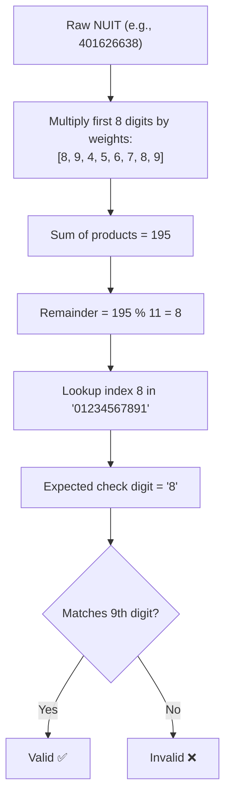

# Identity Documents

Citizens and enterprises in Mozambique use standardized legal identification documents. The most common are the **NUIT** (Unique Tax Identification Number) and the **BI** (National Identity Card). Rigorous validation prevents fraudulent records, financial reconciliation errors, and rejected tax invoices.

---

## ⚙️ NUIT Mechanics & Modulo 11 Algorithm

Unlike foreign tax IDs, the Mozambican Tax Authority (AT) utilizes a specific Modulo 11 algorithm with fixed weights `[8, 9, 4, 5, 6, 7, 8, 9]` and a check string `"01234567891"`.



---

## Validate NUIT

The validation API is uniform across all supported languages:

<div className="code-tabs" data-labels="TypeScript,Python,PHP,Dart,Kotlin">

```ts
import { isValidNUIT } from 'moz-utils';

console.log(isValidNUIT("400000008")); // true
console.log(isValidNUIT("400000009")); // false
```

```python
from moz_utils import is_valid_nuit

print(is_valid_nuit("400000008")) # True
```

```php
use MozUtils\MozUtils;

echo MozUtils::isValidNUIT("400000008"); // true
```

```dart
import 'package:moz_utils/moz_utils.dart';

print(isValidNUIT('400000008')); // true
```

```kotlin
import com.edmilsonmuacigarro.mozutils.MozUtils

println(MozUtils.isValidNUIT("400000008")) // true
```

</div>

---

## Determine NUIT Entity Type

The leading digit of a NUIT identifies the entity class:

<div className="code-tabs" data-labels="TypeScript,Python,PHP,Dart,Kotlin">

```ts
import { getNUITEntityType } from 'moz-utils';

console.log(getNUITEntityType("400000008")); // "Colectiva (Sociedades por Quotas, SA, etc.)"
console.log(getNUITEntityType("500000008")); // "Público (Instituições do Estado e Ministérios)"
```

```python
from moz_utils import get_nuit_entity_type

print(get_nuit_entity_type("400000008"))
```

```php
use MozUtils\MozUtils;

echo MozUtils::getNUITEntityType("400000008");
```

```dart
import 'package:moz_utils/moz_utils.dart';

print(getNUITEntityType('400000008'));
```

```kotlin
import com.edmilsonmuacigarro.mozutils.MozUtils

println(MozUtils.getNUITEntityType("400000008"))
```

</div>

---

## Validate National Identity Card (BI)

A Mozambican BI requires exactly 12 numeric digits followed by a single uppercase letter (e.g., `110100000000A`).

<div className="code-tabs" data-labels="TypeScript,Python,PHP,Dart,Kotlin">

```ts
import { isValidBI } from 'moz-utils';

console.log(isValidBI("110100000000A")); // true
console.log(isValidBI("1101000000001")); // false
```

```python
from moz_utils import is_valid_bi

print(is_valid_bi("110100000000A")) # True
```

```php
use MozUtils\MozUtils;

echo MozUtils::isValidBI("110100000000A"); // true
```

```dart
import 'package:moz_utils/moz_utils.dart';

print(isValidBI('110100000000A')); // true
```

```kotlin
import com.edmilsonmuacigarro.mozutils.MozUtils

println(MozUtils.isValidBI("110100000000A")) // true
```

</div>

---

## Passports, Foreign Resident IDs (DIRE) and Driving Licenses

Validate additional Mozambican identity documents with full backward compatibility:

<div className="code-tabs" data-labels="TypeScript,Python,PHP,Dart,Kotlin">

```ts
import { isValidPassport, isValidDIRE, isValidDrivingLicense } from 'moz-utils';

isValidPassport("AO1234567");      // true
isValidDIRE("120345678A");         // true (SENAMI)
isValidDrivingLicense("MP1234567"); // true (INATRO)
```

```python
from moz_utils import is_valid_passport, is_valid_dire, is_valid_driving_license

print(is_valid_passport("AO1234567"))
print(is_valid_dire("120345678A"))
print(is_valid_driving_license("MP1234567"))
```

```php
use MozUtils\MozUtils;

echo MozUtils::isValidPassport("AO1234567");
echo MozUtils::isValidDIRE("120345678A");
echo MozUtils::isValidDrivingLicense("MP1234567");
```

```dart
import 'package:moz_utils/moz_utils.dart';

print(isValidPassport('AO1234567'));
print(isValidDIRE('120345678A'));
print(isValidDrivingLicense('MP1234567'));
```

```kotlin
import com.edmilsonmuacigarro.mozutils.MozUtils

println(MozUtils.isValidPassport("AO1234567"))
println(MozUtils.isValidDIRE("120345678A"))
println(MozUtils.isValidDrivingLicense("MP1234567"))
```

</div>
