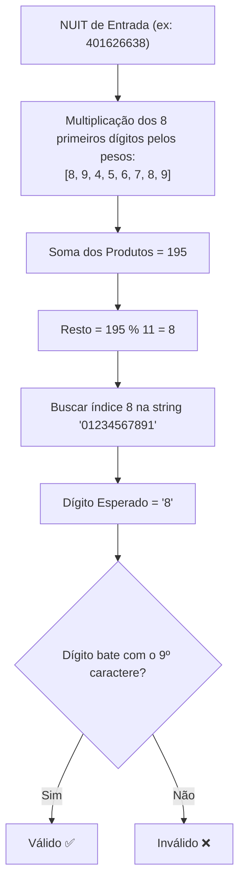

# Documentos de Identidade

Os cidadãos e empresas em Moçambique utilizam diversos documentos oficiais de identificação. Os mais comuns são o **NUIT** (Número Único de Identificação Tributária) e o **BI** (Bilhete de Identidade). Validar estes documentos com precisão matemática evita cadastros corrompidos e falhas de faturamento.

---

## ⚙️ Arquitetura e Cálculo do NUIT (Módulo 11 da AT)

Ao contrário de sistemas como o NIF português, a Autoridade Tributária de Moçambique (AT) implementa pesos específicos `[8, 9, 4, 5, 6, 7, 8, 9]` e uma tabela mapeadora `"01234567891"`.



---

## Validar o NUIT

A validação do NUIT está disponível com assinaturas idênticas em todos os ecossistemas:

<div className="code-tabs" data-labels="TypeScript,Python,PHP,Dart,Kotlin">

```ts
import { isValidNUIT } from 'moz-utils';

console.log(isValidNUIT("400000008")); // true
console.log(isValidNUIT("400000009")); // false
```

```python
from moz_utils import is_valid_nuit

print(is_valid_nuit("400000008")) # True
print(is_valid_nuit("400000009")) # False
```

```php
use MozUtils\MozUtils;

echo MozUtils::isValidNUIT("400000008"); // true
```

```dart
import 'package:moz_utils/moz_utils.dart';

print(isValidNUIT('400000008')); // true
```

```kotlin
import com.edmilsonmuacigarro.mozutils.MozUtils

println(MozUtils.isValidNUIT("400000008")) // true
```

</div>

---

## Identificar o Tipo de Entidade pelo NUIT

O primeiro dígito do NUIT classifica o tipo fiscal da entidade:

<div className="code-tabs" data-labels="TypeScript,Python,PHP,Dart,Kotlin">

```ts
import { getNUITEntityType } from 'moz-utils';

console.log(getNUITEntityType("100000000")); // "Singular (Cidadãos nacionais/estrangeiros e ENI)"
console.log(getNUITEntityType("400000008")); // "Colectiva (Sociedades por Quotas, SA, etc.)"
console.log(getNUITEntityType("500000008")); // "Público (Instituições do Estado e Ministérios)"
```

```python
from moz_utils import get_nuit_entity_type

print(get_nuit_entity_type("400000008")) # "Colectiva (Sociedades por Quotas, SA, etc.)"
```

```php
use MozUtils\MozUtils;

echo MozUtils::getNUITEntityType("400000008");
```

```dart
import 'package:moz_utils/moz_utils.dart';

print(getNUITEntityType('400000008'));
```

```kotlin
import com.edmilsonmuacigarro.mozutils.MozUtils

println(MozUtils.getNUITEntityType("400000008"))
```

</div>

---

## Validar o Bilhete de Identidade (BI)

O BI moçambicano é composto por 12 dígitos seguidos de uma única letra maiúscula (ex: `110100000000A`).

<div className="code-tabs" data-labels="TypeScript,Python,PHP,Dart,Kotlin">

```ts
import { isValidBI } from 'moz-utils';

console.log(isValidBI("110100000000A")); // true
console.log(isValidBI("1101000000001")); // false (último caractere deve ser letra)
```

```python
from moz_utils import is_valid_bi

print(is_valid_bi("110100000000A")) # True
```

```php
use MozUtils\MozUtils;

echo MozUtils::isValidBI("110100000000A"); // true
```

```dart
import 'package:moz_utils/moz_utils.dart';

print(isValidBI('110100000000A')); // true
```

```kotlin
import com.edmilsonmuacigarro.mozutils.MozUtils

println(MozUtils.isValidBI("110100000000A")) // true
```

</div>

---

## Passaporte, DIRE e Carta de Condução

Validação de documentos adicionais com retrocompatibilidade entre formatos legados e modernos:

<div className="code-tabs" data-labels="TypeScript,Python,PHP,Dart,Kotlin">

```ts
import { isValidPassport, isValidDIRE, isValidDrivingLicense } from 'moz-utils';

// Passaporte
isValidPassport("AO1234567"); // true

// DIRE (Legado e Biométrico SENAMI)
isValidDIRE("00008312C");    // true
isValidDIRE("120345678A");   // true

// Carta de Condução (Legado e Biométrico INATRO)
isValidDrivingLicense("M123456");   // true
isValidDrivingLicense("MP1234567"); // true
```

```python
from moz_utils import is_valid_passport, is_valid_dire, is_valid_driving_license

print(is_valid_passport("AO1234567"))
print(is_valid_dire("120345678A"))
print(is_valid_driving_license("MP1234567"))
```

```php
use MozUtils\MozUtils;

echo MozUtils::isValidPassport("AO1234567");
echo MozUtils::isValidDIRE("120345678A");
echo MozUtils::isValidDrivingLicense("MP1234567");
```

```dart
import 'package:moz_utils/moz_utils.dart';

print(isValidPassport('AO1234567'));
print(isValidDIRE('120345678A'));
print(isValidDrivingLicense('MP1234567'));
```

```kotlin
import com.edmilsonmuacigarro.mozutils.MozUtils

println(MozUtils.isValidPassport("AO1234567"))
println(MozUtils.isValidDIRE("120345678A"))
println(MozUtils.isValidDrivingLicense("MP1234567"))
```

</div>

---

## Exemplo Real: Sanitização e Validação de Formulário

Veja como estruturar uma validação completa de entrada do utilizador:

```ts
import { isValidNUIT, isValidBI, formatMozambicanPhone } from 'moz-utils';

export function validateCustomerRegistration(payload: {
  nuit: string;
  bi: string;
  phone: string;
}) {
  const cleanNUIT = payload.nuit.replace(/\D/g, '');
  const cleanBI = payload.bi.trim().toUpperCase();

  if (!isValidNUIT(cleanNUIT)) {
    throw new Error('NUIT inválido conforme as diretrizes da Autoridade Tributária.');
  }

  if (!isValidBI(cleanBI)) {
    throw new Error('Formato de Bilhete de Identidade (BI) inválido.');
  }

  return {
    nuit: cleanNUIT,
    bi: cleanBI,
    phone: formatMozambicanPhone(payload.phone),
  };
}
```
