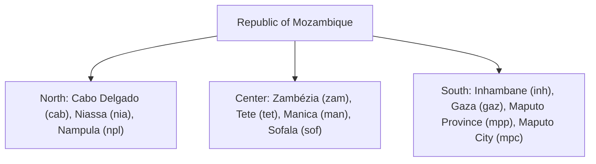

# Geography & Districts

`moz-utils` embeds an offline database covering all 11 provinces and over 160 districts of Mozambique with zero API dependencies.

---

## 🗺️ Administrative Divisions



---

## List Provinces (`mozambiqueProvinces`)

<div className="code-tabs" data-labels="TypeScript,Python,PHP,Dart,Kotlin">

```ts
import { mozambiqueProvinces } from 'moz-utils';

console.log(mozambiqueProvinces[0]);
// { id: "cab", name: "Cabo Delgado", region: "Norte" }
console.log(mozambiqueProvinces[2].name); // "Nampula"
```

```python
from moz_utils import MOZAMBIQUE_PROVINCES

print(MOZAMBIQUE_PROVINCES[0])
print(MOZAMBIQUE_PROVINCES[2]['name']) // "Nampula"
```

```php
use MozUtils\MozUtils;

print_r(MozUtils::getProvinces());
```

```dart
import 'package:moz_utils/moz_utils.dart';

print(mozambiqueProvinces[0]);
print(mozambiqueProvinces[2].name); // "Nampula"
```

```kotlin
import com.edmilsonmuacigarro.mozutils.MozUtils

println(MozUtils.provinces[0])
println(MozUtils.provinces[2].name) // "Nampula"
```

</div>

---

## Get Districts by Province (`getDistrictsByProvince`)

<div className="code-tabs" data-labels="TypeScript,Python,PHP,Dart,Kotlin">

```ts
import { getDistrictsByProvince } from 'moz-utils';

const districts = getDistrictsByProvince('npl');
console.log(districts);
// ["Angoche", "Eráti", "Nampula (Cidade)", "Ribáuè", ...]
```

```python
from moz_utils import get_districts_by_province

print(get_districts_by_province('npl'))
```

```php
use MozUtils\MozUtils;

print_r(MozUtils::getDistrictsByProvince('npl'));
```

```dart
import 'package:moz_utils/moz_utils.dart';

print(getDistrictsByProvince('npl'));
```

```kotlin
import com.edmilsonmuacigarro.mozutils.MozUtils

println(MozUtils.getDistrictsByProvince("npl"))
```

</div>
