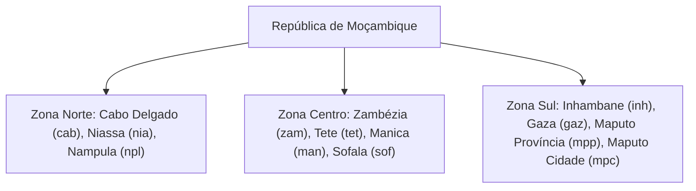

# Geografia & Distritos

O `moz-utils` empacota uma base de dados geográfica offline cobrindo todas as 11 províncias e mais de 160 distritos de Moçambique, sem necessidade de consultas a APIs de terceiros.

---

## 🗺️ Divisão Administrativa Nacional



---

## Listar Províncias (`mozambiqueProvinces`)

Obtenha a lista estruturada com código ISO/ID, nome oficial e região geográfica:

<div className="code-tabs" data-labels="TypeScript,Python,PHP,Dart,Kotlin">

```ts
import { mozambiqueProvinces } from 'moz-utils';

console.log(mozambiqueProvinces[0]);
// { id: "cab", name: "Cabo Delgado", region: "Norte" }
console.log(mozambiqueProvinces[2].name); // "Nampula"
```

```python
from moz_utils import MOZAMBIQUE_PROVINCES

print(MOZAMBIQUE_PROVINCES[0])
print(MOZAMBIQUE_PROVINCES[2]['name']) # "Nampula"
```

```php
use MozUtils\MozUtils;

print_r(MozUtils::getProvinces());
```

```dart
import 'package:moz_utils/moz_utils.dart';

print(mozambiqueProvinces[0]);
print(mozambiqueProvinces[2].name); // "Nampula"
```

```kotlin
import com.edmilsonmuacigarro.mozutils.MozUtils

println(MozUtils.provinces[0])
println(MozUtils.provinces[2].name) // "Nampula"
```

</div>

---

## Obter Distritos por Província (`getDistrictsByProvince`)

Passe o ID da província (ex: `npl`, `sof`, `mpc`) para popular selects encadeados de endereço:

<div className="code-tabs" data-labels="TypeScript,Python,PHP,Dart,Kotlin">

```ts
import { getDistrictsByProvince } from 'moz-utils';

const distritosNampula = getDistrictsByProvince('npl');
console.log(distritosNampula);
// ["Angoche", "Eráti", "Ilha de Moçambique", "Malema", "Meconta", "Mecubúri", "Memba", "Mogincual", "Mogovolas", "Moma", "Monapo", "Mossuril", "Muecate", "Murrupula", "Nacala-a-Velha", "Nacala Porto", "Nampula (Cidade)", "Ribáuè", ...]
```

```python
from moz_utils import get_districts_by_province

distritos = get_districts_by_province('npl')
print(distritos)
```

```php
use MozUtils\MozUtils;

$distritos = MozUtils::getDistrictsByProvince('npl');
print_r($distritos);
```

```dart
import 'package:moz_utils/moz_utils.dart';

final distritos = getDistrictsByProvince('npl');
print(distritos);
```

```kotlin
import com.edmilsonmuacigarro.mozutils.MozUtils

val distritos = MozUtils.getDistrictsByProvince("npl")
println(distritos)
```

</div>

---

## Obter Todos os Distritos Nacionais (`getAllDistricts`)

Retorna a lista completa com província associada para pesquisa global ou autocomplete:

<div className="code-tabs" data-labels="TypeScript,Python,PHP,Dart,Kotlin">

```ts
import { getAllDistricts } from 'moz-utils';

const todos = getAllDistricts();
console.log(todos.length); // 161 distritos
```

```python
from moz_utils import get_all_districts

todos = get_all_districts()
print(len(todos))
```

```php
use MozUtils\MozUtils;

$todos = MozUtils::getAllDistricts();
echo count($todos);
```

```dart
import 'package:moz_utils/moz_utils.dart';

final todos = getAllDistricts();
print(todos.length);
```

```kotlin
import com.edmilsonmuacigarro.mozutils.MozUtils

val todos = MozUtils.getAllDistricts()
println(todos.size)
```

</div>

---

## Tabela de Códigos Oficiais de Província

| Código | Província | Região | Capital Provincial |
|---|---|---|---|
| `cab` | Cabo Delgado | Norte | Pemba |
| `nia` | Niassa | Norte | Lichinga |
| `npl` | Nampula | Norte | Nampula |
| `zam` | Zambézia | Centro | Quelimane |
| `tet` | Tete | Centro | Tete |
| `man` | Manica | Centro | Chimoio |
| `sof` | Sofala | Centro | Beira |
| `inh` | Inhambane | Sul | Inhambane |
| `gaz` | Gaza | Sul | Xai-Xai |
| `mpp` | Maputo Província | Sul | Matola |
| `mpc` | Maputo Cidade | Sul | Maputo |
