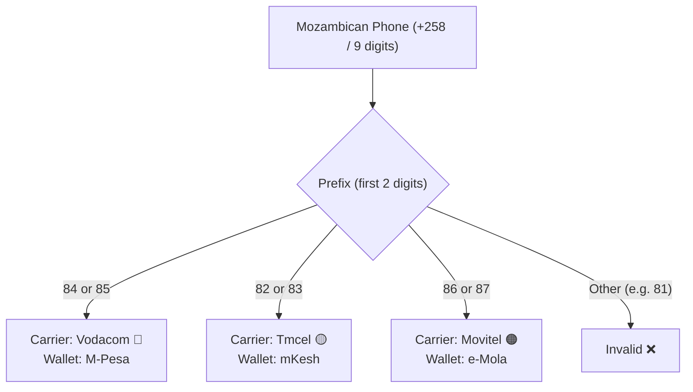

# Phones & Mobile

Validating, normalizing, and resolving mobile operators and financial wallets is vital for e-commerce, fintechs, and delivery services in Mozambique.

---

## 🗺️ Operator & Mobile Wallet Mapping (INCM)

The National Communications Institute of Mozambique (INCM) allocates 9-digit ranges with country code `+258`:



---

## Validate Mobile Numbers

`isValidMozambicanPhone` cleans formatting, parentheses, dashes, and international prefixes (`+258`, `00258`):

<div className="code-tabs" data-labels="TypeScript,Python,PHP,Dart,Kotlin">

```ts
import { isValidMozambicanPhone } from 'moz-utils';

console.log(isValidMozambicanPhone("841234567"));          // true
console.log(isValidMozambicanPhone("+258 82 123 4567"));    // true
console.log(isValidMozambicanPhone("811234567"));           // false
```

```python
from moz_utils import is_valid_mozambican_phone

print(is_valid_mozambican_phone("841234567"))          # True
```

```php
use MozUtils\MozUtils;

echo MozUtils::isValidMozambicanPhone("841234567"); // true
```

```dart
import 'package:moz_utils/moz_utils.dart';

print(isValidMozambicanPhone('841234567')); // true
```

```kotlin
import com.edmilsonmuacigarro.mozutils.MozUtils

println(MozUtils.isValidMozambicanPhone("841234567")) // true
```

</div>

---

## Identify Carrier and Mobile Wallet

Resolve network operators and payment wallets to route customer payments:

<div className="code-tabs" data-labels="TypeScript,Python,PHP,Dart,Kotlin">

```ts
import { getMobileOperator, getMobileWallet } from 'moz-utils';

console.log(getMobileOperator("841234567")); // "Vodacom"
console.log(getMobileWallet("841234567"));   // "M-Pesa"

console.log(getMobileOperator("861234567")); // "Movitel"
console.log(getMobileWallet("861234567"));   // "e-Mola"
```

```python
from moz_utils import get_mobile_operator, get_mobile_wallet

print(get_mobile_operator("841234567")) # "Vodacom"
print(get_mobile_wallet("841234567"))   # "M-Pesa"
```

```php
use MozUtils\MozUtils;

echo MozUtils::getMobileOperator("841234567"); // "Vodacom"
echo MozUtils::getMobileWallet("841234567");   // "M-Pesa"
```

```dart
import 'package:moz_utils/moz_utils.dart';

print(getMobileOperator('841234567'));
print(getMobileWallet('841234567'));
```

```kotlin
import com.edmilsonmuacigarro.mozutils.MozUtils

println(MozUtils.getMobileOperator("841234567"))
println(MozUtils.getMobileWallet("841234567"))
```

</div>

---

## International Formatting

Standardize numbers into canonical international format:

<div className="code-tabs" data-labels="TypeScript,Python,PHP,Dart,Kotlin">

```ts
import { formatMozambicanPhone } from 'moz-utils';

console.log(formatMozambicanPhone("84 123 4567")); // "+258 84 123 4567"
```

```python
from moz_utils import format_mozambican_phone

print(format_mozambican_phone("84 123 4567"))
```

```php
use MozUtils\MozUtils;

echo MozUtils::formatMozambicanPhone("84 123 4567");
```

```dart
import 'package:moz_utils/moz_utils.dart';

print(formatMozambicanPhone('84 123 4567'));
```

```kotlin
import com.edmilsonmuacigarro.mozutils.MozUtils

println(MozUtils.formatMozambicanPhone("84 123 4567"))
```

</div>
