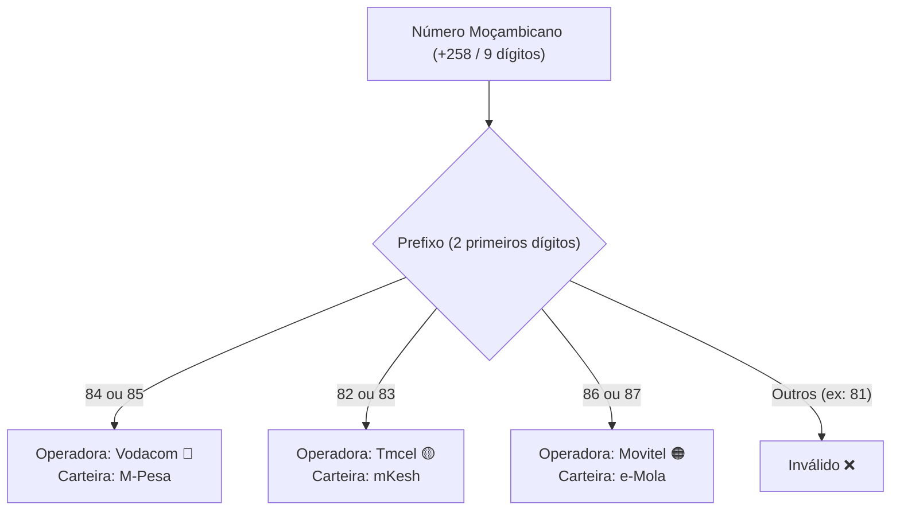

# Telefones & Mobile

Validar, normalizar e identificar operadoras de telemóvel e carteiras financeiras moçambicanas é vital para qualquer aplicação de comércio eletrónico, fintech ou sistemas de mensageria em Moçambique.

---

## 🗺️ Mapa de Prefixos e Carteiras Móveis (INCM)

O Instituto Nacional das Comunicações de Moçambique (INCM) regula a alocação de blocos numéricos de 9 dígitos com o código de país `+258`:



---

## Validar Número de Telemóvel

A função `isValidMozambicanPhone` aceita variantes com espaços, traços, parênteses e indicativos (`+258`, `00258`):

<div className="code-tabs" data-labels="TypeScript,Python,PHP,Dart,Kotlin">

```ts
import { isValidMozambicanPhone } from 'moz-utils';

console.log(isValidMozambicanPhone("841234567"));          // true
console.log(isValidMozambicanPhone("+258 82 123 4567"));    // true
console.log(isValidMozambicanPhone("811234567"));           // false (prefixo não alocado)
```

```python
from moz_utils import is_valid_mozambican_phone

print(is_valid_mozambican_phone("841234567"))          # True
print(is_valid_mozambican_phone("+258 82 123 4567"))    # True
```

```php
use MozUtils\MozUtils;

echo MozUtils::isValidMozambicanPhone("841234567"); // true
```

```dart
import 'package:moz_utils/moz_utils.dart';

print(isValidMozambicanPhone('841234567')); // true
```

```kotlin
import com.edmilsonmuacigarro.mozutils.MozUtils

println(MozUtils.isValidMozambicanPhone("841234567")) // true
```

</div>

---

## Identificar Operadora e Carteira Móvel

Descubra a qual rede e provedor de pagamento móvel pertence o número para rotear cobranças via API:

<div className="code-tabs" data-labels="TypeScript,Python,PHP,Dart,Kotlin">

```ts
import { getMobileOperator, getMobileWallet } from 'moz-utils';

console.log(getMobileOperator("841234567")); // "Vodacom"
console.log(getMobileWallet("841234567"));   // "M-Pesa"

console.log(getMobileOperator("861234567")); // "Movitel"
console.log(getMobileWallet("861234567"));   // "e-Mola"

console.log(getMobileOperator("821234567")); // "Tmcel"
console.log(getMobileWallet("821234567"));   // "mKesh"
```

```python
from moz_utils import get_mobile_operator, get_mobile_wallet

print(get_mobile_operator("841234567")) # "Vodacom"
print(get_mobile_wallet("841234567"))   # "M-Pesa"
```

```php
use MozUtils\MozUtils;

echo MozUtils::getMobileOperator("841234567"); // "Vodacom"
echo MozUtils::getMobileWallet("841234567");   // "M-Pesa"
```

```dart
import 'package:moz_utils/moz_utils.dart';

print(getMobileOperator('841234567')); // 'Vodacom'
print(getMobileWallet('841234567'));   // 'M-Pesa'
```

```kotlin
import com.edmilsonmuacigarro.mozutils.MozUtils

println(MozUtils.getMobileOperator("841234567")) // "Vodacom"
println(MozUtils.getMobileWallet("841234567"))   // "M-Pesa"
```

</div>

---

## Formatação Internacional

Padronize números antes de salvar em bancos de dados ou disparar SMS:

<div className="code-tabs" data-labels="TypeScript,Python,PHP,Dart,Kotlin">

```ts
import { formatMozambicanPhone } from 'moz-utils';

console.log(formatMozambicanPhone("84 123 4567")); // "+258 84 123 4567"
```

```python
from moz_utils import format_mozambican_phone

print(format_mozambican_phone("84 123 4567")) # "+258 84 123 4567"
```

```php
use MozUtils\MozUtils;

echo MozUtils::formatMozambicanPhone("84 123 4567");
```

```dart
import 'package:moz_utils/moz_utils.dart';

print(formatMozambicanPhone('84 123 4567'));
```

```kotlin
import com.edmilsonmuacigarro.mozutils.MozUtils

println(MozUtils.formatMozambicanPhone("84 123 4567"))
```

</div>

---

## Gerador de Links para WhatsApp

Crie URLs do WhatsApp (`wa.me`) prontas para atendimento e conversão:

```ts
import { buildWhatsAppUrl } from 'moz-utils';

const url = buildWhatsAppUrl(
  "841234567",
  "Olá! Gostaria de confirmar a encomenda para Maputo."
);

console.log(url);
// "https://wa.me/258841234567?text=Ol%C3%A1%21%20Gostaria%20de%20confirmar%20a%20encomenda%20para%20Maputo."
```
