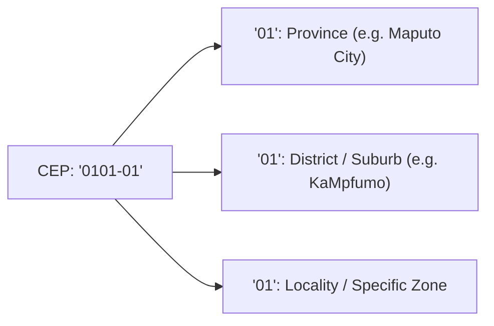

# Postal Codes (CEP)

Mozambique transitions from the classic 4-digit post codes to the modern 6-digit **Postal Addressing Code (CEP)** (`XXXX-XX`). `moz-utils` provides an embedded offline geographical database for both systems.

---

## 🏛️ Modern 6-Digit CEP Architecture



---

## Validate Modern CEP (`isValidNewCEP`)

Requires 4 digits, a hyphen, and 2 digits (`XXXX-XX`):

<div className="code-tabs" data-labels="TypeScript,Python,PHP,Dart,Kotlin">

```ts
import { isValidNewCEP } from 'moz-utils';

console.log(isValidNewCEP("3100-05")); // true (Namutequeliua, Nampula)
console.log(isValidNewCEP("310005"));  // false (missing hyphen)
```

```python
from moz_utils import is_valid_new_cep

print(is_valid_new_cep("3100-05")) # True
```

```php
use MozUtils\MozUtils;

echo MozUtils::isValidNewCEP("3100-05"); // true
```

```dart
import 'package:moz_utils/moz_utils.dart';

print(isValidNewCEP('3100-05')); // true
```

```kotlin
import com.edmilsonmuacigarro.mozutils.MozUtils

println(MozUtils.isValidNewCEP("3100-05")) // true
```

</div>

---

## Search & Autocomplete CEPs (`suggestCEPs`)

<div className="code-tabs" data-labels="TypeScript,Python,PHP,Dart,Kotlin">

```ts
import { suggestCEPs } from 'moz-utils';

const results = suggestCEPs("namutequeliua");
console.log(results[0]);
// { cep: "3100-05", province: "Nampula", district: "Nampula", locality: "Namutequeliua" }
```

```python
from moz_utils import suggest_ceps

results = suggest_ceps("namutequeliua")
print(results[0])
```

```php
use MozUtils\MozUtils;

$results = MozUtils::suggestCEPs("namutequeliua");
print_r($results[0]);
```

```dart
import 'package:moz_utils/moz_utils.dart';

final results = suggestCEPs('namutequeliua');
print(results[0].cep);
```

```kotlin
import com.edmilsonmuacigarro.mozutils.MozUtils

val results = MozUtils.suggestCEPs("namutequeliua")
println(results[0].cep)
```

</div>

---

## Legacy 4-Digit Postal Codes

<div className="code-tabs" data-labels="TypeScript,Python,PHP,Dart,Kotlin">

```ts
import { isValidPostalCode, getPostalCodeLocality } from 'moz-utils';

console.log(isValidPostalCode("3100"));     // true
console.log(getPostalCodeLocality("3100")); // "Nampula ECP"
```

```python
from moz_utils import is_valid_postal_code, get_postal_code_locality

print(is_valid_postal_code("3100"))     # True
print(get_postal_code_locality("3100")) # "Nampula ECP"
```

```php
use MozUtils\MozUtils;

echo MozUtils::isValidPostalCode("3100");     // true
echo MozUtils::getPostalCodeLocality("3100"); // "Nampula ECP"
```

```dart
import 'package:moz_utils/moz_utils.dart';

print(isValidPostalCode('3100'));     // true
print(getPostalCodeLocality('3100')); // 'Nampula ECP'
```

```kotlin
import com.edmilsonmuacigarro.mozutils.MozUtils

println(MozUtils.isValidPostalCode("3100"))     // true
println(MozUtils.getPostalCodeLocality("3100")) // "Nampula ECP"
```

</div>
