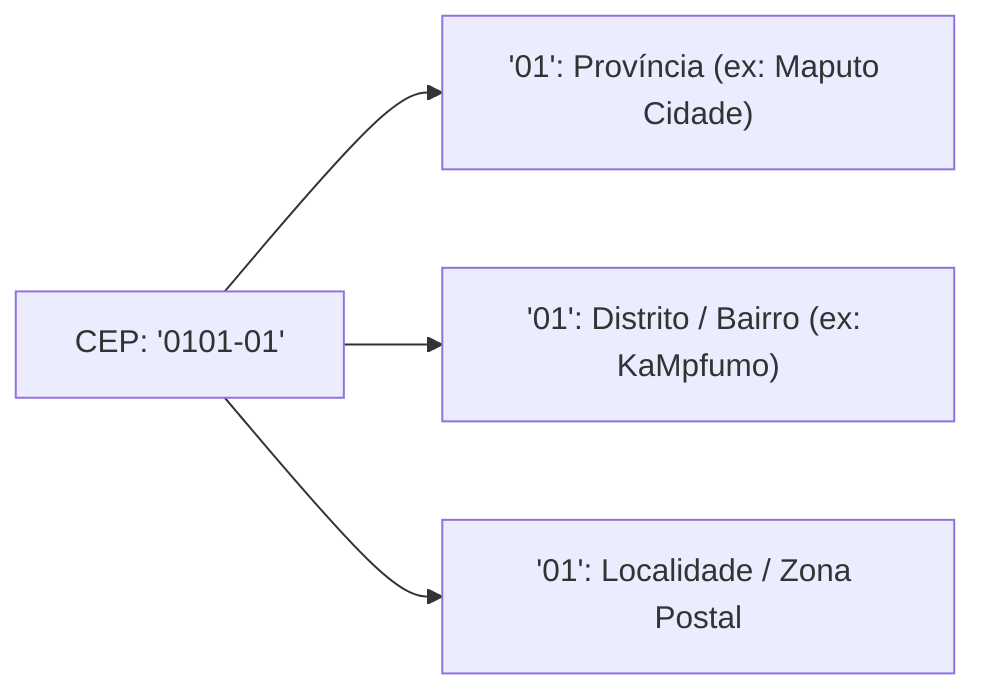

# Códigos Postais (CEP)

Moçambique implementou a transição do antigo código postal de 4 dígitos para o **Novo Código de Endereçamento Postal (CEP)** de 6 dígitos (`XXXX-XX`). O `moz-utils` é a primeira biblioteca open-source a integrar a base de dados geográfica offline completa para ambos os sistemas.

---

## 🏛️ Estrutura do Novo CEP (6 Dígitos)

O novo sistema é geo-espacial e hierárquico:



---

## Validar o Novo CEP (`isValidNewCEP`)

O novo formato exige rigorosamente 4 dígitos, um hífen e 2 dígitos (`XXXX-XX`):

<div className="code-tabs" data-labels="TypeScript,Python,PHP,Dart,Kotlin">

```ts
import { isValidNewCEP } from 'moz-utils';

console.log(isValidNewCEP("3100-05")); // true (Namutequeliua, Nampula)
console.log(isValidNewCEP("310005"));  // false (ausência obrigatória de hífen)
console.log(isValidNewCEP("9999-99")); // false (prefixo de província inexistente)
```

```python
from moz_utils import is_valid_new_cep

print(is_valid_new_cep("3100-05")) # True
print(is_valid_new_cep("310005"))  # False
```

```php
use MozUtils\MozUtils;

echo MozUtils::isValidNewCEP("3100-05"); // true
```

```dart
import 'package:moz_utils/moz_utils.dart';

print(isValidNewCEP('3100-05')); // true
```

```kotlin
import com.edmilsonmuacigarro.mozutils.MozUtils

println(MozUtils.isValidNewCEP("3100-05")) // true
```

</div>

---

## Sugestão e Autocomplete de CEPs (`suggestCEPs`)

Pesquise localidades e distritos em tempo real para campos com autocomplete em formulários de entrega:

<div className="code-tabs" data-labels="TypeScript,Python,PHP,Dart,Kotlin">

```ts
import { suggestCEPs } from 'moz-utils';

const resultados = suggestCEPs("namutequeliua");
console.log(resultados[0]);
// {
//   cep: "3100-05",
//   province: "Nampula",
//   district: "Nampula",
//   locality: "Namutequeliua"
// }
```

```python
from moz_utils import suggest_ceps

resultados = suggest_ceps("namutequeliua")
print(resultados[0])
```

```php
use MozUtils\MozUtils;

$resultados = MozUtils::suggestCEPs("namutequeliua");
print_r($resultados[0]);
```

```dart
import 'package:moz_utils/moz_utils.dart';

final resultados = suggestCEPs('namutequeliua');
print(resultados[0].cep); // "3100-05"
```

```kotlin
import com.edmilsonmuacigarro.mozutils.MozUtils

val resultados = MozUtils.suggestCEPs("namutequeliua")
println(resultados[0].cep) // "3100-05"
```

</div>

---

## Códigos Postais Legados (4 Dígitos)

Para sistemas legados ou formulários simples:

<div className="code-tabs" data-labels="TypeScript,Python,PHP,Dart,Kotlin">

```ts
import { isValidPostalCode, getPostalCodeLocality, getPostalCodeProvince } from 'moz-utils';

console.log(isValidPostalCode("3100"));     // true
console.log(getPostalCodeLocality("3100")); // "Nampula ECP"
console.log(getPostalCodeProvince("3100")); // "Nampula"
console.log(getPostalCodeLocality("1100")); // "Maputo ECP (Sede)"
console.log(getPostalCodeLocality("2100")); // "Beira ECP"
```

```python
from moz_utils import is_valid_postal_code, get_postal_code_locality, get_postal_code_province

print(is_valid_postal_code("3100"))      # True
print(get_postal_code_locality("3100"))  # "Nampula ECP"
print(get_postal_code_province("3100"))  # "Nampula"
```

```php
use MozUtils\MozUtils;

echo MozUtils::isValidPostalCode("3100");       // true
echo MozUtils::getPostalCodeLocality("3100");   // "Nampula ECP"
echo MozUtils::getPostalCodeProvince("3100");   // "Nampula"
```

```dart
import 'package:moz_utils/moz_utils.dart';

print(isValidPostalCode('3100'));     // true
print(getPostalCodeLocality('3100')); // 'Nampula ECP'
print(getPostalCodeProvince('3100')); // 'Nampula'
```

```kotlin
import com.edmilsonmuacigarro.mozutils.MozUtils

println(MozUtils.isValidPostalCode("3100"))     // true
println(MozUtils.getPostalCodeLocality("3100")) // "Nampula ECP"
println(MozUtils.getPostalCodeProvince("3100")) // "Nampula"
```

</div>
