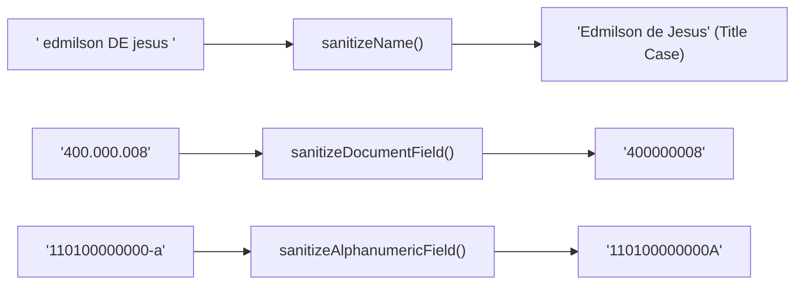

# Data Sanitization & Normalization

In enterprise applications, registration forms, and data integration pipelines, user inputs often arrive poorly formatted—cluttered with extra whitespace, invalid punctuation, or inconsistent casing.

`moz-utils` provides purpose-built utilities for cleansing and normalizing Mozambican identity records and personal data.

---

## 🧹 Sanitization Pipeline



---

## Validate Personal Names (`isValidName`)

`isValidName` verifies whether a string represents a plausible personal name. It requires at least 2 Unicode alphabetic characters (supporting accents) and rejects digits, symbols, or orphaned punctuation like `---`:

<div className="code-tabs" data-labels="TypeScript,Python,PHP,Dart,Kotlin">

```ts
import { isValidName } from 'moz-utils';

console.log(isValidName("Edmilson Muacigarro")); // true
console.log(isValidName("Graça Machel"));        // true
console.log(isValidName("João d'Almeida"));      // true
console.log(isValidName("---"));                // false
console.log(isValidName("User 123"));           // false
```

```python
from moz_utils import is_valid_name

print(is_valid_name("Edmilson Muacigarro")) # True
print(is_valid_name("---"))                 # False
```

```php
use Iradoweck\MozUtils\MozUtils;

echo MozUtils::isValidName("Edmilson Muacigarro"); // true
```

```dart
import 'package:moz_utils/moz_utils.dart';

print(isValidName('Edmilson Muacigarro')); // true
```

```kotlin
import com.edmilsonmuacigarro.mozutils.MozUtils

println(MozUtils.isValidName("Edmilson Muacigarro")) // true
```

</div>

---

## Sanitize and Format Names (`sanitizeName`)

`sanitizeName` collapses irregular whitespace, eliminates forbidden symbols, and formats names into standard **Title Case**, keeping Portuguese connecting particles (`de`, `da`, `do`, `dos`, `das`, `e`) in lowercase:

<div className="code-tabs" data-labels="TypeScript,Python,PHP,Dart,Kotlin">

```ts
import { sanitizeName } from 'moz-utils';

// Converts uppercase input while preserving lowercase particles
console.log(sanitizeName("EDMILSON DE JESUS MUACIGARRO"));
// "Edmilson de Jesus Muacigarro"

// Cleans excess whitespace
console.log(sanitizeName("   samora    moisés   machel   "));
// "Samora Moisés Machel"

// Optional allCaps mode for official identity records
console.log(sanitizeName("josina machel", { allCaps: true }));
// "JOSINA MACHEL"
```

```python
from moz_utils import sanitize_name

print(sanitize_name("EDMILSON DE JESUS MUACIGARRO"))
# "Edmilson de Jesus Muacigarro"
```

```php
use Iradoweck\MozUtils\MozUtils;

echo MozUtils::sanitizeName("EDMILSON DE JESUS MUACIGARRO");
// "Edmilson de Jesus Muacigarro"
```

```dart
import 'package:moz_utils/moz_utils.dart';

print(sanitizeName('EDMILSON DE JESUS MUACIGARRO'));
// "Edmilson de Jesus Muacigarro"
```

```kotlin
import com.edmilsonmuacigarro.mozutils.MozUtils

println(MozUtils.sanitizeName("EDMILSON DE JESUS MUACIGARRO"))
// "Edmilson de Jesus Muacigarro"
```

</div>

---

## Sanitize Numeric Document Fields (`sanitizeDocumentField`)

Strips out any character that is not a numeric digit (`0-9`). Ideal for preparing raw NUIT, NIB, or phone number inputs before validation:

<div className="code-tabs" data-labels="TypeScript,Python,PHP,Dart,Kotlin">

```ts
import { sanitizeDocumentField, isValidNUIT } from 'moz-utils';

const userInput = " 400.000.008 ";
const cleanNUIT = sanitizeDocumentField(userInput);

console.log(cleanNUIT);          // "400000008"
console.log(isValidNUIT(cleanNUIT)); // true
```

```python
from moz_utils import sanitize_document_field

clean = sanitize_document_field(" 400.000.008 ")
print(clean) # "400000008"
```

```php
use Iradoweck\MozUtils\MozUtils;

$clean = MozUtils::sanitizeDocumentField(" 400.000.008 ");
echo $clean; // "400000008"
```

```dart
import 'package:moz_utils/moz_utils.dart';

final clean = sanitizeDocumentField(' 400.000.008 ');
print(clean); // "400000008"
```

```kotlin
import com.edmilsonmuacigarro.mozutils.MozUtils

val clean = MozUtils.sanitizeDocumentField(" 400.000.008 ")
println(clean) // "400000008"
```

</div>

---

## Sanitize Alphanumeric Document Fields (`sanitizeAlphanumericField`)

Strips out punctuation, spaces, and special symbols, enforcing strict UPPERCASE characters. Perfect for Mozambican BIs, DIREs, Passports, and Driver Licenses:

<div className="code-tabs" data-labels="TypeScript,Python,PHP,Dart,Kotlin">

```ts
import { sanitizeAlphanumericField, isValidBI } from 'moz-utils';

const dirtyBI = " 110100000000 - a ";
const cleanBI = sanitizeAlphanumericField(dirtyBI);

console.log(cleanBI);       // "110100000000A"
console.log(isValidBI(cleanBI)); // true
```

```python
from moz_utils import sanitize_alphanumeric_field

clean = sanitize_alphanumeric_field(" 110100000000 - a ")
print(clean) # "110100000000A"
```

```php
use Iradoweck\MozUtils\MozUtils;

$clean = MozUtils::sanitizeAlphanumericField(" 110100000000 - a ");
echo $clean; // "110100000000A"
```

```dart
import 'package:moz_utils/moz_utils.dart';

final clean = sanitizeAlphanumericField(' 110100000000 - a ');
print(clean); // "110100000000A"
```

```kotlin
import com.edmilsonmuacigarro.mozutils.MozUtils

val clean = MozUtils.sanitizeAlphanumericField(" 110100000000 - a ")
println(clean) // "110100000000A"
```

</div>
