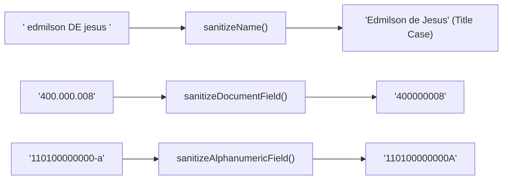

# Saneamento e Normalização de Dados

Em sistemas empresariais, formulários de cadastro e pipelines de integração, os dados inseridos por utilizadores chegam frequentemente desformatados, com espaços redundantes, caracteres especiais indevidos ou misturas caóticas de maiúsculas e minúsculas. 

O `moz-utils` oferece utilitários especializados para higienização e padronização de dados cadastrais de acordo com as normas de escrita e registo civil em Moçambique.

---

## 🧹 Pipeline de Higienização



---

## Validar Nomes Pessoais (`isValidName`)

A função `isValidName` verifica se uma dada sequência representa um nome pessoal plausível. Exige um mínimo de 2 caracteres alfabéticos Unicode (suportando acentuação) e rejeita números, pontuações avulsas ou sequências como `---`:

<div className="code-tabs" data-labels="TypeScript,Python,PHP,Dart,Kotlin">

```ts
import { isValidName } from 'moz-utils';

console.log(isValidName("Edmilson Muacigarro")); // true
console.log(isValidName("Graça Machel"));        // true (suporta caracteres especiais)
console.log(isValidName("João d'Almeida"));      // true (suporta apóstrofo e preposições)
console.log(isValidName("---"));                // false (sem letras)
console.log(isValidName("User 123"));           // false (números proibidos em nomes)
```

```python
from moz_utils import is_valid_name

print(is_valid_name("Edmilson Muacigarro")) # True
print(is_valid_name("---"))                 # False
```

```php
use Iradoweck\MozUtils\MozUtils;

echo MozUtils::isValidName("Edmilson Muacigarro"); // true
```

```dart
import 'package:moz_utils/moz_utils.dart';

print(isValidName('Edmilson Muacigarro')); // true
```

```kotlin
import com.edmilsonmuacigarro.mozutils.MozUtils

println(MozUtils.isValidName("Edmilson Muacigarro")) // true
```

</div>

---

## Sanitizar e Formatar Nomes (`sanitizeName`)

A função `sanitizeName` normaliza o espaçamento, elimina caracteres espúrios e formata o nome no padrão **Title Case** da língua portuguesa, mantendo as partículas de ligação (`de`, `da`, `do`, `dos`, `das`, `e`) em minúsculas:

<div className="code-tabs" data-labels="TypeScript,Python,PHP,Dart,Kotlin">

```ts
import { sanitizeName } from 'moz-utils';

// Converte texto em MAIÚSCULAS mantendo partículas em minúsculas
console.log(sanitizeName("EDMILSON DE JESUS MUACIGARRO"));
// "Edmilson de Jesus Muacigarro"

// Limpa múltiplos espaços e pontuações espúrias
console.log(sanitizeName("   samora    moisés   machel   "));
// "Samora Moisés Machel"

// Opção para forçar todas as letras em MAIÚSCULAS (padrão de documentos oficiais)
console.log(sanitizeName("josina machel", { allCaps: true }));
// "JOSINA MACHEL"
```

```python
from moz_utils import sanitize_name

print(sanitize_name("EDMILSON DE JESUS MUACIGARRO"))
# "Edmilson de Jesus Muacigarro"
```

```php
use Iradoweck\MozUtils\MozUtils;

echo MozUtils::sanitizeName("EDMILSON DE JESUS MUACIGARRO");
// "Edmilson de Jesus Muacigarro"
```

```dart
import 'package:moz_utils/moz_utils.dart';

print(sanitizeName('EDMILSON DE JESUS MUACIGARRO'));
// "Edmilson de Jesus Muacigarro"
```

```kotlin
import com.edmilsonmuacigarro.mozutils.MozUtils

println(MozUtils.sanitizeName("EDMILSON DE JESUS MUACIGARRO"))
// "Edmilson de Jesus Muacigarro"
```

</div>

---

## Sanitizar Documentos Numéricos (`sanitizeDocumentField`)

Remove qualquer caractere que não seja dígito numérico (`0-9`). Essencial para preparar campos de NUIT, NIB ou telefone antes da validação matemática:

<div className="code-tabs" data-labels="TypeScript,Python,PHP,Dart,Kotlin">

```ts
import { sanitizeDocumentField, isValidNUIT } from 'moz-utils';

const userInput = " 400.000.008 ";
const cleanNUIT = sanitizeDocumentField(userInput);

console.log(cleanNUIT);          // "400000008"
console.log(isValidNUIT(cleanNUIT)); // true
```

```python
from moz_utils import sanitize_document_field

clean = sanitize_document_field(" 400.000.008 ")
print(clean) # "400000008"
```

```php
use Iradoweck\MozUtils\MozUtils;

$clean = MozUtils::sanitizeDocumentField(" 400.000.008 ");
echo $clean; // "400000008"
```

```dart
import 'package:moz_utils/moz_utils.dart';

final clean = sanitizeDocumentField(' 400.000.008 ');
print(clean); // "400000008"
```

```kotlin
import com.edmilsonmuacigarro.mozutils.MozUtils

val clean = MozUtils.sanitizeDocumentField(" 400.000.008 ")
println(clean) // "400000008"
```

</div>

---

## Sanitizar Campos Alfanuméricos (`sanitizeAlphanumericField`)

Remove símbolos, espaços e caracteres especiais, forçando todas as letras para MAIÚSCULAS. Perfeito para Bilhetes de Identidade (BI), DIRE, Passaportes e Cartas de Condução:

<div className="code-tabs" data-labels="TypeScript,Python,PHP,Dart,Kotlin">

```ts
import { sanitizeAlphanumericField, isValidBI } from 'moz-utils';

const dirtyBI = " 110100000000 - a ";
const cleanBI = sanitizeAlphanumericField(dirtyBI);

console.log(cleanBI);       // "110100000000A"
console.log(isValidBI(cleanBI)); // true
```

```python
from moz_utils import sanitize_alphanumeric_field

clean = sanitize_alphanumeric_field(" 110100000000 - a ")
print(clean) # "110100000000A"
```

```php
use Iradoweck\MozUtils\MozUtils;

$clean = MozUtils::sanitizeAlphanumericField(" 110100000000 - a ");
echo $clean; // "110100000000A"
```

```dart
import 'package:moz_utils/moz_utils.dart';

final clean = sanitizeAlphanumericField(' 110100000000 - a ');
print(clean); // "110100000000A"
```

```kotlin
import com.edmilsonmuacigarro.mozutils.MozUtils

val clean = MozUtils.sanitizeAlphanumericField(" 110100000000 - a ")
println(clean) // "110100000000A"
```

</div>
