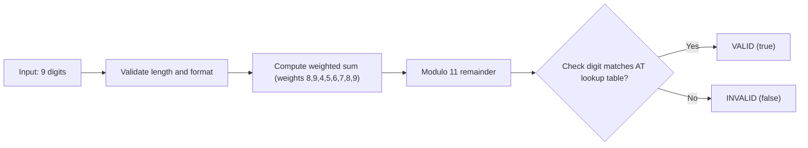

# Troubleshooting

Practical solutions for common integration challenges when using `moz-utils` in Mozambican enterprise software.

---

## 1. NUIT Validation Fails on Real Customer Data
**Symptom:** `isValidNUIT()` returns `false` on a taxpayer ID submitted by a real user.  
**Root Cause:** Mozambican NUIT numbers (under Decree n.º 28/2012) use a strict Modulo 11 check digit algorithm with specific weights `[8, 9, 4, 5, 6, 7, 8, 9]`.

**Solution:**
- Always sanitize whitespace and punctuation before validating:
  ```ts
  const cleanNUIT = rawInput.replace(/\D/g, "");
  const isValid = isValidNUIT(cleanNUIT);
  ```
- Mozambican tax authorities (e-Tributação) strictly enforce this check digit; do not bypass validation.

---

## 2. Phone Formats: `+258` vs Local Input
**Symptom:** Inconsistent phone formats across web forms and mobile apps.  
**Solution:**
- Normalize all input with `formatMozambicanPhone()`:
  ```ts
  formatMozambicanPhone("841234567");      // "+258 84 123 4567"
  formatMozambicanPhone("+258841234567");   // "+258 84 123 4567"
  ```
- Determine mobile wallets for checkout routing:
  ```ts
  getMobileOperator("841234567"); // "Vodacom"
  getMobileWallet("841234567");   // "M-Pesa"
  ```

---

## 3. National ID (BI): Character Casing
**Symptom:** Valid BI fails validation.  
**Solution:**
- Mozambican BIs consist of 12 digits followed by a single uppercase letter (e.g., `110100000000A`). Always normalize:
  ```ts
  isValidBI(input.trim().toUpperCase());
  ```

---

## 4. Postal Codes: Legacy 4-digit vs New 6-digit CEP
**Symptom:** Querying `1100` in modern CEP searches yields no results.  
**Root Cause:** Mozambique operates two parallel postal numbering systems:
1. **Legacy (4 digits):** E.g., `1100` (Maputo City), `3100` (Nampula), `2300` (Tete). Use `isValidPostalCode()` and `getPostalCodeLocality()`.
2. **New CEP (6 digits):** E.g., `0101-01` (geo-addressed by province, district, and locality). Use `isValidNewCEP()` and `suggestCEPs()`.

---

## 5. Modules in Node.js and TypeScript (ESM)
**Symptom:** `Error: require() of ES Module moz-utils is not supported`.  
**Root Cause:** The `moz-utils` package is distributed as modern pure ECMAScript Modules (ESM) for lightweight execution across browsers, edge workers, and modern runtimes.  
**Solution:**
1. Ensure your `package.json` specifies module type:
   ```json
   { "type": "module" }
   ```
2. In your code, always use standard `import` syntax:
   ```ts
   import { isValidNUIT, formatMZN } from 'moz-utils';
   ```

