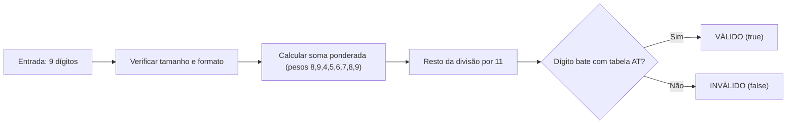

# Resolução de Problemas (Troubleshooting)

Este guia prático aborda os desafios mais comuns encontrados por desenvolvedores ao integrar o `moz-utils` em produção em Moçambique.

---

## 1. NUIT Falha na Validação de Clientes Reais
**Sintoma:** A função `isValidNUIT()` retorna `false` para um documento que o cliente jura ser autêntico.  
**Causa Técnica:** O NUIT em Moçambique (Decreto n.º 28/2012) não é uma sequência aleatória de 9 dígitos. O 9º dígito é um **Dígito Verificador (DV)** calculado por uma soma ponderada módulo 11 com pesos `[8, 9, 4, 5, 6, 7, 8, 9]`.

**Como Resolver:**
- Verifique se o utilizador digitou o número com espaços, traços ou pontos. Execute sempre a sanitização antes de validar:
  ```ts
  const rawInput = " 400.000.008 ";
  const cleanInput = rawInput.replace(/\D/g, "");
  const valid = isValidNUIT(cleanInput);
  ```
- O sistema tributário (e-Tributação) rejeitará cadastros com DV divergente; nunca ignore o retorno da função.

---

## 2. Formato de Telefones: `+258` vs Prefixo Local
**Sintoma:** O número `+258 84 123 4567` falha se passado para regex simples.  
**Causa Técnica:** Utilizadores fornecem números com formatos diversos: `841234567`, `+258841234567`, `00258841234567` ou `(258) 84-123-4567`.  
**Como Resolver:**
- Utilize `formatMozambicanPhone(input)` para normalizar qualquer variante para o formato internacional canónico:
  ```ts
  formatMozambicanPhone("841234567");      // "+258 84 123 4567"
  formatMozambicanPhone("+258841234567");   // "+258 84 123 4567"
  ```
- Para saber qual operadora ou carteira móvel cobrar, utilize os métodos integrados:
  ```ts
  getMobileOperator("841234567"); // "Vodacom"
  getMobileWallet("841234567");   // "M-Pesa"
  ```

---

## 3. Bilhete de Identidade (BI): Letra Final e Tamanho
**Sintoma:** O BI retorna falso mesmo parecendo correto.  
**Causa Técnica:** O Bilhete de Identidade moçambicano é estritamente composto por **12 algarismos seguidos por 1 letra maiúscula** (ex: `110100000000A`).
**Como Resolver:**
- Certifique-se de que a letra final está em maiúscula e sem espaços:
  ```ts
  const cleanBI = input.trim().toUpperCase();
  isValidBI(cleanBI);
  ```

---

## 4. Códigos Postais: CEP Legado (4 dígitos) vs Novo CEP (6 dígitos)
**Sintoma:** Consultar `1100` na busca do novo CEP não retorna dados.  
**Causa Técnica:** Moçambique possui dois sistemas em coexistência:
1. **Legado (4 dígitos):** Ex: `1100` (Maputo Cidade), `3100` (Tete). Use `isValidPostalCode()` e `getPostalCodeLocality()`.
2. **Novo CEP (6 dígitos):** Ex: `0101-01` (geo-endereçado por província, distrito e localidade). Use `isValidNewCEP()` e `suggestCEPs()`.

---

## 5. Módulos no Node.js e TypeScript (ESM)
**Sintoma:** `Error: require() of ES Module moz-utils is not supported`.  
**Causa Técnica:** O pacote `moz-utils` é distribuído em ESM nativo moderno para garantir leveza e compatibilidade com navegadores e edge computing.  
**Como Resolver:**
1. No seu `package.json`, certifique-se de ter:
   ```json
   { "type": "module" }
   ```
2. No seu código, utilize sempre `import`:
   ```ts
   import { isValidNUIT, formatMZN } from 'moz-utils';
   ```
